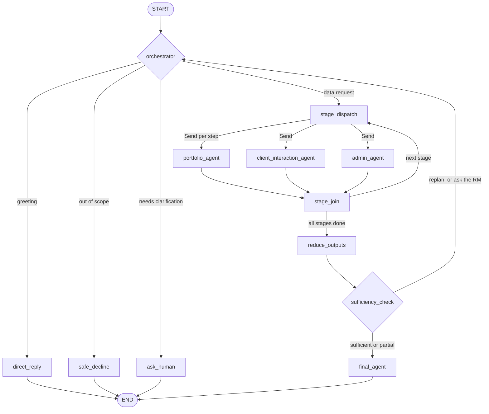

# rm-agent

Agentic FastAPI backend for Relationship Managers (RMs). It answers RM questions about portfolios, client
interactions and administrative topics, grounded in tool data with citations. It is reached through its own REST/SSE
API or as a Unique AI external module (webhook).

---

## 1. Quick start

Requirements: Python 3.14 and [uv](https://docs.astral.sh/uv/) (recommended) or pip. Run every command from the
project root.

```powershell
# 1. Install dependencies (uv also installs the dev tools: pytest, ruff, httpx)
uv sync --extra unique

# 2. Create your settings file and fill in the Unique credentials (section 5)
Copy-Item .env.example .env

# 3. Start the server
uv run main.py

# 4. Check it is up
curl http://127.0.0.1:8000/health
```

Open the interactive API docs at http://127.0.0.1:8000/docs (ReDoc: `/redoc`, schema: `/openapi.json`).

Install with pip instead of uv:

```powershell
python -m venv .venv
.venv\Scripts\Activate.ps1
pip install -e ".[unique]"
pip install pytest pytest-asyncio httpx ruff   # dev tools, only needed for tests
python main.py
```

Optional extras (combine as needed, e.g. `uv sync --extra unique --extra openai`, or `uv sync --all-extras`):

| Extra | Installs | Needed when |
|---|---|---|
| `unique` | `unique-sdk` | `LLM_PROVIDER=unique_ai`, webhook replies, chat history, admin agent (normal setup) |
| `openai` | `langchain-openai` | `LLM_PROVIDER=openai` (OpenAI-compatible LLM as a service) |
| `phoenix` | `arize-phoenix` + OpenTelemetry | running a local Phoenix trace viewer (`phoenix serve`) |

---

## 2. Running the app

### 2.1 Command-line options

`main.py` takes these options. Every one is optional. When an option is not given, the value comes from the env
file (or the code default).

| Option | Example | What it does |
|---|---|---|
| `--env-file PATH` | `--env-file .env.local` | Load settings from this file instead of `.env` in the project root. A relative path is resolved from the current directory. |
| `--host HOST` | `--host 127.0.0.1` | Interface to bind. `0.0.0.0` = reachable from other machines, `127.0.0.1` = this machine only. Overrides `HOST`. |
| `--port PORT` | `--port 8010` | Port to listen on. Overrides `PORT`. |
| `--log-level LEVEL` | `--log-level debug` | `critical`, `error`, `warning`, `info`, `debug` or `trace`. Overrides `LOG_LEVEL`. |
| `--debug` | `--debug` | Sets `DEBUG=true` for this run only (FastAPI debug mode). |
| `--reload` | `--reload` | Restart automatically when code changes (development). Overrides `RELOAD`. |
| `--no-reload` | `--no-reload` | Force auto-reload off, even if `RELOAD=true`. |

### 2.2 Common ways to start

```powershell
# Defaults from .env
uv run main.py

# Explicit host, port, log level, auto-reload
uv run main.py --host 0.0.0.0 --port 8000 --log-level debug --reload

# A different env file (e.g. one per environment) on another port
uv run main.py --env-file .env.local --port 8010

# Same with plain Python (inside the activated venv)
python main.py --env-file .env.uat --host 127.0.0.1 --port 9000

# Installed console script (same options as main.py)
uv run rm-agent --port 8010
```

Running uvicorn directly (it does not accept `--env-file`; set `APP_ENV_FILE` instead):

```powershell
$env:APP_ENV_FILE = ".env.local"
uvicorn main:app --host 0.0.0.0 --port 8000 --reload
```

### 2.3 Where a setting's value comes from

From highest to lowest priority:

1. Command-line option (`--host`, `--port`, `--log-level`, `--debug`, `--reload` / `--no-reload`)
2. Environment variable of the process, e.g. `$env:PORT = "8010"` in the current PowerShell session
3. The env file: `--env-file`, else `APP_ENV_FILE`, else `.env` in the project root
4. The default in `app/config.py`

So any setting in section 5 can be changed for one run without editing the file:

```powershell
$env:LOG_FORMAT = "text"; $env:SSE_ENABLED = "true"; uv run main.py
```

Environment variables stay set for the whole PowerShell session. Remove one with `Remove-Item Env:LOG_FORMAT`.

> When you change the port, also change `SSE_WEBHOOK_URL` if the SSE listener is on (section 3). It must point at
> the port this app listens on.

### 2.4 Docker

```powershell
docker build -t rm-agent .
docker run --rm -p 8000:8000 --env-file .env rm-agent
# Fewer workers (default 4); use 1 when SSE_ENABLED=true (section 3.4)
docker run --rm -p 8000:8000 --env-file .env -e WEB_CONCURRENCY=1 rm-agent
```

The image runs gunicorn with uvicorn workers on port 8000. `WEB_CONCURRENCY` sets the number of workers.

### 2.5 What a healthy start looks like

The startup log shows:
- `[STARTUP] configuration_loaded`, with the provider, model, port and feature flags in use.
- `[STARTUP] settings_incomplete ... missing=...`, which lists the required settings that are empty. The app
  still starts, but the affected features fail.
- `[STARTUP] database disabled (POSTGRES_ENABLED=false)` or `initialised`.
- `[STARTUP] sse_listener_disabled` or `sse_listener_starting` (section 3).

Logs go to the console and to `logs/app.log` (JSON by default; set `LOG_FORMAT=text` for readable lines locally).

---

## 3. Connecting to Unique locally (SSE listener)

In production, Unique calls this app's webhook `POST /relationship-manager/webhook`. On a laptop, Unique cannot reach
`localhost`, so the app subscribes to Unique's **Event Socket** (Server-Sent Events) instead. It forwards each event
to its own webhook. No ngrok or public URL is needed.

```text
Unique chat ──(event)──> Unique Event Socket (SSE) ──> SSE listener ──POST──> /relationship-manager/webhook ──> agent
                                                                                                          └──> reply written to the Unique chat
```

There are two ways to run the listener. Use **one** of them, not both.

### 3.1 Option A (recommended): built-in listener, started with the app

1. Set these in your env file:

   ```env
   # Unique credentials (also used for the LLM and the chat replies)
   UNIQUE_API_BASE_URL=https://gateway.<tenant>.unique.app/public/chat
   UNIQUE_APP_ID=<app id>
   UNIQUE_APP_KEY=<app key>
   UNIQUE_COMPANY_ID=<company id>
   UNIQUE_USER_ID=<user id>
   UNIQUE_MODEL_NAME=AZURE_GPT_4o_2024_1120

   # Forwarded events are not signed, so verification must be off
   UNIQUE_WEBHOOK_VERIFY_SIGNATURE=false

   # Built-in SSE listener
   SSE_ENABLED=true
   SSE_URL=https://gateway.<tenant>.unique.app/public/event-socket/events/stream
   SSE_SUBSCRIPTIONS=unique.chat.external-module.chosen
   SSE_WEBHOOK_URL=http://127.0.0.1:8000/relationship-manager/webhook
   SSE_ASSISTANT_ID=            # optional: only handle events of this assistant/space
   SSE_MAX_CONCURRENT=10
   ```

   `SSE_URL` has no query string; the app adds `?subscriptions=` from `SSE_SUBSCRIPTIONS`.

2. Start the app:

   ```powershell
   uv run main.py
   ```

3. In the Unique UI, open the space that uses this external module and send a message. If you set
   `UNIQUE_WEBHOOK_EXPECTED_MODULE_NAME`, the module name must match it.

4. Follow it in the log:

   | Log line | Meaning |
   |---|---|
   | `[SSE] listener_started` | Listener task is running |
   | `[SSE] connected status=200` | Subscribed to the Event Socket |
   | `[SSE] forwarded event=... handled=True` | Event passed to the webhook and accepted |
   | `[SSE] event_ignored reason=other_assistant` | Filtered out by `SSE_ASSISTANT_ID` |
   | `[WEBHOOK] accepted ... model=...` | Turn started (with the model chosen in Unique, if any) |
   | `[WEBHOOK] handled chat_id=... duration_ms=...` | Reply written to the Unique chat |
   | `[WEBHOOK] ignored reason=...` | Event not answered (unsupported event, other module, duplicate, empty text) |
   | `[SSE] connect_rejected status=401/403` | Wrong `UNIQUE_APP_KEY` / `UNIQUE_APP_ID` / `UNIQUE_COMPANY_ID` |
   | `[SSE] connection_error` | Wrong `SSE_URL`, proxy or certificate problem; retried every 5 s |

The Event Socket closes connections after about 10 minutes. The listener reconnects by itself after 9 minutes
(`[SSE] reconnecting`).

### 3.2 Option B: standalone forwarder script

Use this when you want to see the events in a separate terminal, or when the app runs without `SSE_ENABLED`. Keep
`SSE_ENABLED=false` so events are not forwarded twice.

```powershell
# Terminal 1: the app
uv run main.py

# Terminal 2: the forwarder (reads UNIQUE_APP_KEY, UNIQUE_APP_ID, UNIQUE_COMPANY_ID, UNIQUE_API_BASE_URL from .env)
python scripts/unique_event_socket_dropin.py --subscriptions unique.chat.external-module.chosen
```

| Option | Default | Purpose |
|---|---|---|
| `--env-file` | `.env` | Env file to read the Unique credentials from |
| `--subscriptions` | `unique.chat.external-module.chosen` | Comma-separated event names |
| `--local-webhook-url` | `http://127.0.0.1:8000/relationship-manager/webhook` | Where to forward events (change it if the app runs on another port) |
| `--stream-url` | derived from `UNIQUE_API_BASE_URL` | Full Event Socket URL, if derivation does not fit your tenant |
| `--api-key`, `--app-id`, `--company-id`, `--unique-api-base-url` | from the env file | Override single credentials |
| `--max-events N` | `0` (unlimited) | Stop after N events (quick checks) |

Examples:

```powershell
python scripts/unique_event_socket_dropin.py --env-file .env.local --local-webhook-url http://127.0.0.1:8010/relationship-manager/webhook
python scripts/unique_event_socket_dropin.py --stream-url https://gateway.<tenant>.unique.app/public/event-socket/events/stream --max-events 3
```

### 3.3 Testing the webhook without Unique

Post an event yourself. With signature verification off, any well-formed event is accepted. The reply is written
back to the Unique chat, so `chatId`/`assistantId` must be real for the write-back to succeed.

```powershell
$body = @'
{
  "id": "evt_test_1",
  "event": "unique.chat.external-module.chosen",
  "userId": "<user id>",
  "companyId": "<company id>",
  "payload": {
    "name": "<module name>",
    "chatId": "<chat id>",
    "assistantId": "<assistant id>",
    "userMessage": {"id": "<user message id>", "text": "How is portfolio PF-1001 performing this quarter?"},
    "assistantMessage": {"id": "<assistant message id>"},
    "configuration": {"customerId": "CUST001"},
    "modelChoice": "AZURE_GPT_4o_2024_1120"
  }
}
'@
Invoke-RestMethod -Method Post -Uri http://127.0.0.1:8000/relationship-manager/webhook -ContentType "application/json" -Body $body
```

The webhook responds right away with `{"success": true, "handled": true}` and answers in the background. Sending the
same `id` again returns `duplicate_event`. Change `id` for every test.

### 3.4 How the webhook handles an event

- **Events answered:** `unique.chat.external-module.chosen` and `unique.chat.user-message.created`. All others are
  acknowledged and ignored.
- **Module filter:** if `UNIQUE_WEBHOOK_EXPECTED_MODULE_NAME` is set, external-module events whose `payload.name`
  differs are ignored.
- **Model per turn:** if the payload carries `modelChoice` (the model the user picked in Unique, either a name or
  an object with `name`), that model is the primary for every LLM call of the turn. The configured models
  (`UNIQUE_MODEL_NAME`, `LLM_FALLBACK_MODELS`) stay as fallbacks. Without `modelChoice` the configured models are
  used.
- **Request context:** `payload.configuration.customerId` becomes the client in scope. `portfolioId` is passed
  along as well.
- **Duplicates:** Unique re-delivers slow events, so event ids already accepted in the last 10 minutes are ignored.
  This check is per process. With several gunicorn workers and `SSE_ENABLED=true`, every worker starts its own
  listener, so run a single worker (`WEB_CONCURRENCY=1`) when the listener is on.

---

## 4. API endpoints

| Method and path | Purpose |
|---|---|
| `GET /health` | Liveness, with the database state (`ok`, `unreachable`, `disabled`) |
| `POST /agent/chat` | One RM turn: `{"session_id", "message", "metadata"}` → reply, citations, evaluations |
| `POST /agent/stream` | Same turn, streamed as Server-Sent Events |
| `POST /relationship-manager/webhook` | Unique webhook (section 3) |
| `GET /agent/llm/models` | Models this app is configured to use (primary plus fallbacks) |
| `POST /agent/llm/query` | `{"query": "...", "model": "optional"}` → `{"response", "model", "latency_ms"}`; 400 for an unsupported model, 502 when the call fails |
| `GET /agent/unique/models` | Models available on the Unique platform |
| `POST /agent/unique/models/test` | `{"model", "query"}`: try any Unique model |

Example chat request:

```powershell
$body = '{"session_id": "s-001", "message": "Compare portfolios PF-1001 and PF-2002 for last quarter", "metadata": {"client_id": "CUST001"}}'
Invoke-RestMethod -Method Post -Uri http://127.0.0.1:8000/agent/chat -ContentType "application/json" -Body $body
```

Every response carries an `X-Correlation-ID` header. Send your own to follow a request across systems (section 7).

---

## 5. Configuration reference

All settings are read from the env file (section 2.3) and are defined, with defaults, in `app/config.py`. Start from
`.env.example`; its sample values can differ from the code defaults. Names are case-sensitive. Booleans accept
`true`/`false`.

### 5.1 Server

| Setting | Default | Purpose |
|---|---|---|
| `HOST` | `0.0.0.0` | Interface to bind (`--host` overrides) |
| `PORT` | `8000` | Port (`--port` overrides) |
| `LOG_LEVEL` | `info` | Log verbosity (`--log-level` overrides) |
| `RELOAD` | `false` | Auto-reload on code changes (`--reload` / `--no-reload` override) |
| `DEBUG` | `false` | FastAPI debug mode (`--debug` overrides) |
| `BACKEND_CORS_ORIGINS` | `[]` | Browser origins allowed to call the API, as a JSON list: `["http://localhost:3000"]`. `*` is rejected. |
| `APP_NAME`, `VERSION`, `DESCRIPTION` | | Shown in the API docs, logs and traces |

### 5.2 LLM provider and model

| Setting | Default | Purpose |
|---|---|---|
| `LLM_PROVIDER` | `unique_ai` | `unique_ai`: models through Unique (`unique_sdk.ChatCompletion`). `openai`: any OpenAI-compatible LLM service. |
| `UNIQUE_MODEL_NAME` | | Primary model when `LLM_PROVIDER=unique_ai`, e.g. `AZURE_GPT_4o_2024_1120` (list them with `GET /agent/unique/models`) |
| `LLMAAS_BASE_URL` | | `openai` provider: endpoint, usually ending in `/v1` (required) |
| `LLMAAS_API_KEY` | | `openai` provider: key supplied by the client (required) |
| `LLMAAS_MODEL` | | `openai` provider: model name (required) |
| `LLMAAS_TEMPERATURE` | `0.3` | `openai` provider: sampling temperature |
| `LLMAAS_MAX_TOKENS` | `60000` | `openai` provider: max output tokens |
| `LLM_FALLBACK_MODELS` | | Comma-separated models tried in order when the primary fails (same provider) |
| `LLM_MAX_RETRIES` | `2` | Retries per model for temporary errors (timeout, connection drop, 5xx, 429) |
| `LLM_RETRY_BASE_DELAY` | `1.0` | First retry wait in seconds |
| `LLM_RETRY_BACKOFF_MULTIPLIER` | `2.0` | Wait grows by this factor per retry |
| `LLM_RETRY_MAX_DELAY` | `30.0` | Upper bound of a retry wait |
| `RETRY_JITTER_RATIO` | `0.25` | Random spread on every retry wait (LLM, tools, admin agent), so parallel calls do not retry in lockstep |

Model order for a call: the webhook's `modelChoice` (if sent) → primary model → `LLM_FALLBACK_MODELS`.
Authentication and bad-request errors are not retried; the next model is tried straight away.

### 5.3 Unique platform

| Setting | Default | Purpose |
|---|---|---|
| `UNIQUE_API_BASE_URL` | | Unique API base, e.g. `https://gateway.<tenant>.unique.app/public/chat` |
| `UNIQUE_API_VERSION` | `2023-12-06` | Unique API version sent by the SDK |
| `UNIQUE_APP_ID`, `UNIQUE_APP_KEY` | | App credentials (SDK, Event Socket) |
| `UNIQUE_COMPANY_ID`, `UNIQUE_USER_ID` | | Identity used when a request carries none (API calls, LLM calls). Webhook turns use the event's own user and company. |
| `UNIQUE_STEPS_ENABLED` | `true` | Show per-step progress (orchestrator, agents, …) in the Unique chat while a turn runs |
| `UNIQUE_STREAM_REPLY` | `false` | Push the reply to the chat in chunks before the final save (typing effect) |
| `UNIQUE_STREAM_CHUNK_WORDS` | `40` | Words per chunk when `UNIQUE_STREAM_REPLY=true` |

### 5.4 Webhook security

| Setting | Default | Purpose |
|---|---|---|
| `UNIQUE_WEBHOOK_VERIFY_SIGNATURE` | `false` | `true`: reject requests without a valid `X-Unique-Signature` (production webhook). Keep `false` for the SSE listener and local tests. |
| `UNIQUE_WEBHOOK_ENDPOINT_SECRET` | | Signing secret from Unique. If verification is on and this is empty, the webhook returns `503 verification_unavailable`. |
| `UNIQUE_WEBHOOK_EXPECTED_MODULE_NAME` | | Only answer external-module events of this module name; empty = any |

### 5.5 SSE listener (local development)

| Setting | Default | Purpose |
|---|---|---|
| `SSE_ENABLED` | `false` | Start the built-in Event Socket listener with the app (section 3.1) |
| `SSE_URL` | | Event Socket stream URL: `https://gateway.<tenant>.unique.app/public/event-socket/events/stream` |
| `SSE_SUBSCRIPTIONS` | `unique.chat.external-module.chosen` | Comma-separated events to subscribe to (add `unique.chat.user-message.created` to answer every message in the space) |
| `SSE_WEBHOOK_URL` | `http://127.0.0.1:8000/relationship-manager/webhook` | Where events are forwarded; must match this app's port |
| `SSE_ASSISTANT_ID` | | Only forward events of this assistant (space); empty = all |
| `SSE_MAX_CONCURRENT` | `10` | Events forwarded at the same time; up to 5× this many may wait, more are dropped and logged |

### 5.6 Conversation history

| Setting | Default | Purpose |
|---|---|---|
| `UNIQUE_HISTORY_ENABLED` | `true` | Webhook turns: read earlier messages of the Unique chat as context |
| `HISTORY_RAW_TURNS` | `3` | Most recent turns passed verbatim |
| `HISTORY_SUMMARY_MAX_TURNS` | `20` | Older turns (up to this many) summarised by the LLM |
| `HISTORY_SUMMARY_TIMEOUT_SECONDS` | `30.0` | If the summary takes longer, the turn continues without it |
| `GRAPH_CHECKPOINTER_ENABLED` | `true` | In-process short-term memory per session (history and a pending clarification question). Used by `/agent/chat`, and by webhook turns when the Unique history is unavailable. |

### 5.7 Agent behaviour

| Setting | Default | Purpose |
|---|---|---|
| `MAX_AGENT_ITERATIONS` | `5` | Reason → tool call → observe rounds per agent |
| `AGENT_MAX_REPLAN_LOOPS` | `2` | How often the sufficiency check may send the turn back to the orchestrator to fetch more |
| `AGENT_TOOL_TIMEOUT_SECONDS` | `300.0` | Time limit for one tool call |
| `AGENT_MAX_PARALLEL_TOOL_CALLS` | `8` | Tool calls an agent runs at once |
| `AGENT_EVIDENCE_MAX_CHARS_PER_SOURCE` | `400000` | Characters of one tool result kept as evidence |
| `AGENT_STRUCTURED_OUTPUT_ATTEMPTS` | `2` | Tries to get valid JSON from the LLM (the validation error is sent back each time) |

### 5.8 Admin agent (CLM assistant on Unique)

| Setting | Default | Purpose |
|---|---|---|
| `ADMIN_CLM_ASSISTANT_ID` | (set in code) | Unique assistant the admin agent asks |
| `ADMIN_CLM_CHAT_ID` | | CLM chat reused when `ADMIN_CLM_REUSE_CHAT` is true |
| `ADMIN_CLM_REUSE_CHAT` | `false` | `false`: a new CLM chat per admin query, so earlier questions never shape the answer |
| `ADMIN_CLM_STOP_CONDITION` | `completedAt` | CLM message field awaited; `completedAt` waits until its references are attached |
| `ADMIN_AGENT_TIMEOUT_SECONDS` | `600.0` | Time limit for one CLM answer |
| `ADMIN_AGENT_MAX_RETRIES` | `1` | Retries of a failed CLM call |

### 5.9 Tool retries and circuit breaker

| Setting | Default | Purpose |
|---|---|---|
| `TOOL_MAX_RETRIES` | `2` | Retries of a tool call on temporary errors |
| `TOOL_RETRY_BASE_DELAY`, `TOOL_RETRY_MAX_DELAY` | `1.0`, `8.0` | First and maximum retry wait (seconds); also used by the admin agent |
| `TOOL_RETRY_ON_TIMEOUT` | `false` | Also retry timed-out calls (off: with a 300 s timeout a retry could hold the turn for minutes) |
| `CIRCUIT_BREAKER_FAILURE_THRESHOLD` | `5` | After this many failures in a row, a tool server / CLM space is skipped … |
| `CIRCUIT_BREAKER_COOLDOWN_SECONDS` | `60.0` | … for this long, so a broken dependency fails fast instead of slowing every turn |

### 5.10 Large data (map-reduce)

When tool results are too large for the model's context, they are split into chunks, the relevant facts are extracted
from each chunk in parallel, and the results are merged.

| Setting | Default | Purpose |
|---|---|---|
| `MAP_REDUCE_ENABLED` | `true` | Turn the consolidation on/off |
| `MAP_REDUCE_CONTEXT_WINDOW_TOKENS` | `128000` | Context window of the model in use |
| `MAP_REDUCE_AGENT_CONTEXT_SHARE` | `0.5` | Share of the window tool results may fill inside one agent run |
| `MAP_REDUCE_TRIGGER_TOKENS` | `40000` | A result (or one step's results together) above this is consolidated |
| `MAP_REDUCE_MIN_TOKENS` | `4000` | Results below this are never consolidated |
| `MAP_REDUCE_CHUNK_TOKENS` | `24000` | Chunk size per extraction call |
| `MAP_REDUCE_MAX_PARALLEL` | `4` | Extraction calls at once |
| `MAP_REDUCE_MAX_DEPTH` | `3` | Rounds of merging before giving up |
| `MAP_REDUCE_CHARS_PER_TOKEN` | `3.5` | Characters per token used for the estimates |

### 5.11 Network (client environments)

| Setting | Default | Purpose |
|---|---|---|
| `HTTP_PROXY`, `HTTPS_PROXY`, `NO_PROXY` | | Corporate proxy, applied at startup to all outgoing calls |
| `SSL_CA_CERT_PATH` | | CA bundle for an internal certificate authority |
| `SSL_VERIFY` | `true` | `false` disables certificate checks (self-signed endpoints; never in production) |

### 5.12 Database and audit

| Setting | Default | Purpose |
|---|---|---|
| `POSTGRES_ENABLED` | `false` | Use Postgres; `false` skips all database work (`/health` shows `disabled`) |
| `POSTGRES_HOST`, `POSTGRES_PORT`, `POSTGRES_USER`, `POSTGRES_PASSWORD`, `POSTGRES_DATABASE` | `localhost`, `5432`, `postgres`, ``, `rm_agent` | Connection |
| `DB_STARTUP_REQUIRED` | `false` | `true`: refuse to start if the database is unreachable; `false`: start degraded |
| `DB_CONNECT_TIMEOUT_SECONDS` | `3` | Connect timeout |
| `DB_ECHO` | `false` | Log every SQL statement |
| `AUDIT_ENABLED` | `true` | Write the per-query audit record |

The app initialises the database at startup; `python scripts/init_db.py` does the same without starting the server.

### 5.13 Logging

| Setting | Default | Purpose |
|---|---|---|
| `LOG_FORMAT` | `json` | `json`: one object per line with `correlation_id`, `trace_id`, … (for ELK). `text`: readable, for local work. |
| `ENABLE_FILE_LOGGING` | `true` | Also write log files (console output is always on) |
| `LOG_FILE` | `logs/app.log` | Operational log |
| `AUDIT_LOG_FILE` | `logs/audit.log` | Compliance log: one `query_completed` record per query |
| `LOG_PAYLOAD_MODE` | `short` | `short`: only the first/last characters of prompts, replies and tool results; `full`: everything |
| `LOG_PAYLOAD_EDGE_CHARS` | `200` | Characters kept at each end in `short` mode |

### 5.14 Tracing (Arize Phoenix / Arize AX)

| Setting | Default | Purpose |
|---|---|---|
| `PHOENIX_ENABLED` | `true` | Send traces; if the collector or the packages are missing, the app runs without tracing |
| `PHOENIX_LOCAL_MODE` | `false` | `true`: local Phoenix at `PHOENIX_OTLP_ENDPOINT` (checked for reachability at startup). `false`: deployed collector. |
| `PHOENIX_OTLP_ENDPOINT` | `http://127.0.0.1:6006/v1/traces` | Local collector |
| `PHOENIX_DEPLOYED_OTLP_ENDPOINT` | | Deployed / enterprise collector |
| `PHOENIX_SPACE_ID`, `PHOENIX_API_KEY` | | Deployed mode authentication (sent as `space_id` and `api_key` headers) |
| `PHOENIX_PROJECT_NAME` | `rm-agent` | Project name in Phoenix / Arize |
| `PHOENIX_CAPTURE_MESSAGE_CONTENT` | `true` | Attach prompt and reply text to spans; `false`: metadata and token counts only |
| `PHOENIX_LLM_PROVIDER` | | `llm.provider` on LLM spans; must equal the provider in your Arize cost config. Empty = the `LLM_PROVIDER` name. |
| `PHOENIX_LANGCHAIN_AUTO_INSTRUMENT` | `false` | LangChain auto-instrumentation; duplicates the app's own spans, so keep off |
| `PHOENIX_TIKTOKEN_ESTIMATE` | `false` | Estimate missing token counts with tiktoken instead of ~4 characters per token (needs the vocabulary cached or downloadable) |

Local trace viewer: `uv sync --extra phoenix`, then `phoenix serve`, set `PHOENIX_LOCAL_MODE=true` and open
http://127.0.0.1:6006.

### 5.15 Reserved settings (no effect yet)

These are accepted, so existing env files keep working, but no code reads them yet:
`API_V1_STR`, `DEFAULT_AGENT_TIMEOUT`, `MCP_ENABLED` (only triggers a startup warning when `MCP_SERVER_URL` is empty),
`MCP_SERVER_URL`, `MCP_CRM_SERVER_URL`, `MCP_TRANSPORT`, `MCP_TIMEOUT`, `MCP_MAX_TOOL_ITERATIONS`,
`ENTITLEMENTS_ENABLED`, `GUARDRAILS_ENABLED`, `PII_MASKING_ENABLED`, `LTM_ENABLED`, `QDRANT_*`, `EPISODIC_*`,
`MEMORY_STORAGE_PATH`, `LONG_TERM_MEMORY_PATH`, `MEMORY_DATABASE_URL_OVERRIDE`.

`.env.example` also lists `PHOENIX_SPACE_ID_HEADER`, `PHOENIX_API_KEY_HEADER`, `UNIQUE_AUTH_COMPANY_ID` and
`UNIQUE_AUTH_USER_ID`; they are ignored.

---

## 6. Architecture: multi-agent LangGraph workflow

Every RM message runs through one compiled LangGraph (`app/graph/builder.py`). Entry point: `run_turn()` in
`app/graph/runner.py`.



Print the diagram from the compiled graph with `render_graph_mermaid()` in `app/graph/builder.py`.

### Nodes

| Node | Role |
|---|---|
| `orchestrator` | Phase-adaptive LLM decision: intent, entities, execution plan |
| `direct_reply`, `safe_decline` | End the turn with the text the orchestrator wrote (greeting, polite decline) |
| `ask_human` | Ends the turn with the question as the reply; the pending question is saved for the next turn |
| `stage_dispatch` / `stage_join` | Run the plan stage by stage; steps in one stage run concurrently (LangGraph `Send`) |
| `portfolio_agent`, `client_interaction_agent` | ReAct agents: reason, call tools in parallel, observe, repeat (bounded) |
| `admin_agent` | Asks the CLM assistant on Unique |
| `reduce_outputs` | Renders tool output as evidence text, consolidates oversized outputs and numbers the sources |
| `sufficiency_check` | One LLM judge: coverage, grounding, re-fetch instructions or a question for the RM |
| `final_agent` | Writes the structured markdown answer; only the sources it cites are returned |

### Request flow

1. The API receives the RM query (`/agent/chat`, `/agent/stream`) or a Unique webhook event.
2. Middleware attaches the correlation id (`X-Correlation-ID`).
3. `run_turn` restores the conversation history and runs the graph.
4. The orchestrator replies directly, asks the RM a question, or produces an execution plan.
5. Agents run the plan stage by stage (parallel inside a stage). One stage with one step is single, one stage with
   several steps is parallel, several stages are sequential (a later agent receives earlier findings).
6. Outputs are reduced to evidence text with numbered sources.
7. The sufficiency check approves, loops back to the orchestrator (replan, or a question for the RM), or accepts gaps.
8. The final agent writes the markdown answer; cited sources and evaluations are returned with it.

### Orchestrator phases

One decision schema, a different prompt per phase (`app/prompts/orchestrator/`); the phase is derived from the state
(`app/agents/orchestrator/phase.py`).

| Phase | When | Prompt |
|---|---|---|
| `routing` | Fresh RM message | `routing.py` |
| `clarification_followup` | The RM is answering a question asked on the previous turn | `clarification_followup.py` |
| `replan` | Sufficiency asked for a re-fetch | `replan.py` |
| `human_in_the_loop` | Sufficiency needs input only the RM has | `human_in_the_loop.py` |

### LLM-written text, no canned rules

Greetings, declines, clarification questions, re-fetch instructions and explanations of missing data are written by
the LLM. Output is validated by Pydantic schemas; an invalid answer is sent back with the validation error
(`AGENT_STRUCTURED_OUTPUT_ATTEMPTS`). If the LLM stays unavailable the turn fails with an error instead of a canned
answer. The only deterministic controls are safety limits: replan cap, ReAct iteration cap, tool timeouts, and removal
of citation markers the model invented.

### Scoping with request metadata

The orchestrator extracts the client, portfolio ids, time range and topics from the message. Portfolio ids are taken
only from what the RM typed (the latest message, or earlier messages it refers back to). `client_id` falls back to the
request metadata when the message names no client. If a mandatory detail is missing (e.g. portfolio data is needed but
no id was typed), the RM is asked. Agents call tools once per portfolio id in scope.

Request metadata:
- `client_id`: selected customer (webhook: `payload.configuration.customerId`).
- `active_portfolios`: list of `{"id": ...}`; accepted, but not used to scope portfolio queries.
- `tool_outputs` (request field): accepted for compatibility, ignored.

### Project layout

```text
main.py                entry point (command-line options, uvicorn)
app/
  main.py              FastAPI app factory, startup/shutdown, SSE listener start
  config.py            all settings (section 5)
  constants.py         names, labels and fixed limits
  routes/              FastAPI routers (agent, llm, webhook)
  graph/               state, builder, edges, tasks, nodes/, runner
  agents/              orchestrator/, react_agent, admin_agent, sufficiency, final_agent, formatting
  prompts/             one file per use case; orchestrator/ has one file per phase
  schemas/             Pydantic contracts
  tools/               integrations (placeholders) and the registry that selects them
  services/            LLM routing, Unique chat/webhook/SSE, history, citations, evaluation, audit
  components/          reusable, project-independent code
  observability/       portable tracing/logging package
scripts/               SSE forwarder, DB init, project-structure generator
tests/                 pytest suite
```

### Reusable components (`app/components/`)

Depend only on `langchain-core` and `pydantic`, so they can be copied into another project.

| Component | Use |
|---|---|
| `structured_output.py` | `invoke_structured(llm, messages, Schema, post_validate=...)`: JSON answer, validation, repair retries |
| `react/` | `ReActRunner(llm, tools, system_prompt=..., config=ReActConfig(...))`: bounded tool-calling loop with parallel calls, timeouts, duplicate-call protection |
| `messages.py` | `extract_text` for model message content |

### Integrations

The portfolio and CRM tools in `app/tools/` return deterministic placeholder text. To go live, change only
`app/tools/registry.py` (portfolio: AAA MCP tools; CRM: Outlook and Fano MCP tools). A provider only needs
`get_tools() -> list[BaseTool]`; each tool returns a `ToolOutput` (`content` plus `sources`) so citations work
unchanged.

### Adding another agent

1. Add its id, display name and capability to `app/constants.py` (`AGENT_*`, `AGENT_TO_NODE`, `AGENT_ORDER`) and to
   `AgentId` in `app/schemas/orchestrator.py`.
2. Create the agent (`ReActAgent(agent_id, system_prompt, tool_provider)` or a class with `run(task)`) and its prompt
   file, then register it in `app/graph/dependencies.py` and `app/graph/builder.py`.

---

## 7. Observability

Built on the portable package `app/observability/`; the app's wiring is `app/services/observability.py`.

One query = one trace, and one correlation id ties its spans, metric attributes and log lines together:

| Span | Kind | Created by |
|---|---|---|
| `http.<route>` | CHAIN | API routes and the webhook |
| `query` (root of the query trace) | CHAIN | `run_turn` |
| `node.<graph_node>` | CHAIN | every graph node |
| `agent.<agent>` | AGENT | ReAct agents and the admin agent |
| `tool.<tool>` | TOOL | every tool call and the CLM call |
| `llm.<caller>` (e.g. `llm.orchestrator.routing`) | LLM | the LLM router, once per call |
| `step.<name>` | CHAIN | steps outside the graph (signature check, webhook answer, stream events) |

- Every span carries `app.correlation_id`, `session.id` (Arize Sessions view) and `user.id`.
- LLM spans carry model, provider, input/output messages and token counts (estimated, flagged with
  `app.token_count.estimated`, when the provider returns none), which Arize AX uses for cost.
- Decisions and signals: `app.decision.*` (phase, intent, agents, execution mode, sufficiency verdict, replans) and,
  on the `query` span, `app.query.*` (outcome, partial answer, tool calls, failures, retries) and `app.quality.*`
  (citation count and coverage, out of scope).
- Correlation id: an incoming `X-Correlation-ID` header is kept (max 128 characters), otherwise a UUID is generated.
  It is returned on every response and written on every span and log line next to `trace_id`.

Logs (`LOG_FORMAT=json`) have a `log_stream` field: `operational` (`LOG_FILE`) and `audit` (`AUDIT_LOG_FILE`). Ship
both with Filebeat/Logstash and route on `log_stream` to separate ELK indices with their own retention; restrict the
audit index to the compliance role.

Enterprise Arize AX: `PHOENIX_ENABLED=true`, `PHOENIX_LOCAL_MODE=false`, `PHOENIX_DEPLOYED_OTLP_ENDPOINT`,
`PHOENIX_SPACE_ID`, `PHOENIX_API_KEY`. Then call `/agent/chat` or trigger the webhook and check for nested spans
(request → query → nodes → agents → tools / LLM).

---

## 8. Testing

```powershell
uv run pytest
# or, inside the activated venv
python -m pytest
```

Graph tests use a scripted LLM (`tests/fakes.py`) keyed by prompt phrases, so every phase and loop is tested without a
model.

---

## 9. Troubleshooting

| Symptom | Check |
|---|---|
| `settings_incomplete` at startup | The listed settings are empty in the env file in use. Is the right file loaded (`--env-file`)? |
| `Unsupported LLM_PROVIDER` | Use `unique_ai` or `openai` |
| Every turn fails, `all_models_failed` in the log | Model name valid? (`GET /agent/unique/models`), credentials, proxy/certificates (`SSL_CA_CERT_PATH`, `HTTPS_PROXY`) |
| Nothing happens when chatting in Unique | `SSE_ENABLED=true` and `SSE_URL` set? `[SSE] connected` in the log? `SSE_ASSISTANT_ID` / `UNIQUE_WEBHOOK_EXPECTED_MODULE_NAME` filtering the event out? (section 3.1 table) |
| `[SSE] forward_failed` / connection refused | `SSE_WEBHOOK_URL` port differs from the app's port |
| Webhook returns `400 invalid_signature` | Forwarded/local events are unsigned: set `UNIQUE_WEBHOOK_VERIFY_SIGNATURE=false` |
| Webhook returns `503 verification_unavailable` | Verification on but `UNIQUE_WEBHOOK_ENDPOINT_SECRET` empty |
| Same question answered twice | Built-in listener and forwarder script both running, or several workers with `SSE_ENABLED=true` |
| `phoenix_local_collector_unreachable` | `PHOENIX_LOCAL_MODE=true` but no local Phoenix running; start `phoenix serve` or set `PHOENIX_ENABLED=false` |
| `uv run` fails with "Access is denied" removing dist-info | OneDrive file lock: close running Python processes and retry, or run `.venv\Scripts\python.exe main.py` |
| No DB should be used | `POSTGRES_ENABLED=false` |

---

## 10. Create a project structure (PowerShell)

`scripts/create_project_structure.ps1` scaffolds the same folder layout for a new project:

```powershell
powershell -ExecutionPolicy Bypass -File .\scripts\create_project_structure.ps1 -ProjectRoot "my-new-project"
# overwrite existing files
powershell -ExecutionPolicy Bypass -File .\scripts\create_project_structure.ps1 -ProjectRoot "my-new-project" -Force
```

If script execution is blocked, run once in that terminal: `Set-ExecutionPolicy -Scope Process -ExecutionPolicy Bypass`.
